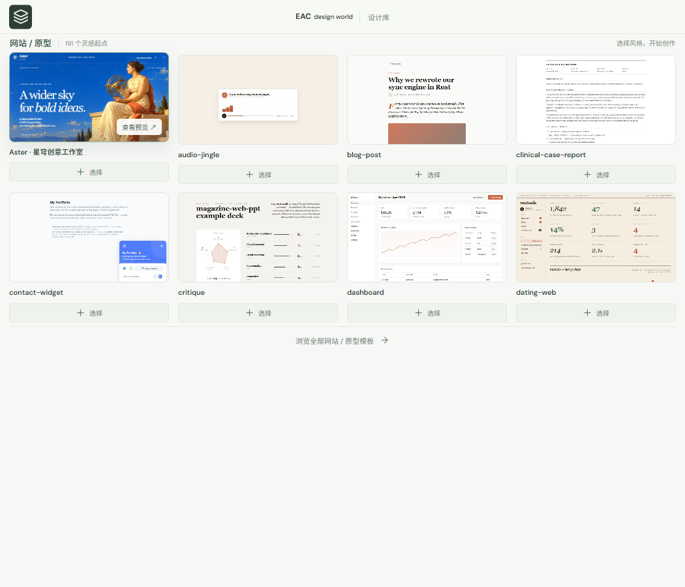
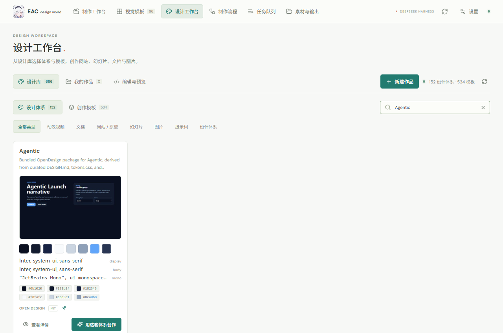

<div align="center">


# EAC design world

**让创作，自成世界。**

DeepSeek Harness 的本地视频制作与设计工作室

[](https://github.com/Ebony-Vinyl/EAC-design-world/releases)
[](LICENSE)
[](https://nodejs.org/)
[](https://github.com/Ebony-Vinyl/EAC-design-world/stargazers)

[下载发布包](https://github.com/Ebony-Vinyl/EAC-design-world/releases) · [快速开始](#快速开始) · [功能一览](#功能一览) · [设计与架构](#设计与架构) · [问题反馈](https://github.com/Ebony-Vinyl/EAC-design-world/issues)

</div>

**把模板、素材、剪辑和设计工程连在一起，让 AI 与你共同完成一件可预览、可修订、可导出的作品。**

EAC design world 为 [DeepSeek Harness](https://github.com/deepseek-ai/deepseek-harness) 提供原生创作模式、模板选择和右侧作品画布，同时拥有可独立运行的本地工作台。视频录制、配音、配乐、字幕、编码与检查产生真实文件；网站、幻灯片、SVG 和文档保留源文件及版本历史。

当前版本为 **v0.6.0 开发预览版**。本版加入参数化调色、变速运镜、网络素材和人工续剪工程导出，并修复凭据状态输出、柔光偏色、预览一致性和导出时序等审查问题，详见 [发布说明](docs/release-v0.6.0.md)。保留 150 个 Shotcraft 镜头、设计库、签名更新与回滚、草稿恢复和隔离预览。独立 MCP 入口支持 macOS 与 Windows，自动发现 Chrome / Edge；旁白支持 macOS say、Windows SAPI 和本地 GPT-SoVITS 曼波中文音色，桌面录制仍仅支持 Windows。模板数量代表可检索内容，不代表每个模板均可离线直接渲染。

<p align="center"><b>以下两条宣传片均为 deepseek harness + EAC design world + deepseek v4.1 flash（非 1017）一轮出的结果</b></p>

<p align="center"><b>AI 全程自己录制素材和制作音乐</b></p>

<p align="center"><b>EAC design world · RUSH 60s</b></p>

https://github.com/user-attachments/assets/3f6641e0-e803-48cf-b61a-2baa57f2c088

<p align="center"><b>Our Free Model · 65s</b></p>

https://github.com/user-attachments/assets/ca081273-1061-4656-a1b7-41d50af0aec7

顶部“音频模板”提供默认音色和曼波中文，可试听、设为默认，并将曼波模型下载到本机。本地曼波中文配音的安装、默认音色和验收方式见 [配音接入说明](docs/local-mambo-voice.md)。

## 目录

| 开始使用 | 创作能力 | 开发与来源 |
| :--- | :--- | :--- |
| [下载与安装](#下载与安装)<br />[环境要求](#环境要求)<br />[快速开始](#快速开始) | [功能一览](#功能一览)<br />[设计内容库](#设计内容库)<br />[AI 与 MCP](#ai-与-mcp) | [设计与架构](#设计与架构)<br />[开发与验证](#开发与验证)<br />[许可证与致谢](#许可证与致谢) |

## 功能一览

| 你想完成的工作 | 插件提供的能力 |
| --- | --- |
| 从对话开始创作 | 正常、剪辑、Design 三种模式；模板区独立铺开，选择状态不覆盖正文；重复点击或标签上的 × 可取消 |
| 找到合适的视觉风格 | 152 套设计体系与 517 个 OpenDesign 模板条目，另有原有 17 个视频选项；按类型搜索、分类和分页 |
| 浏览与挑选动效镜头 | Shotcraft 本地快照含 150 个镜头、10 类动效、59 个精选；可见视频预览、选片单、名单复制与下载、导入项目素材 |
| 录下真实产品 | Edge 网页操作录制；Windows 桌面录制；原素材不被改写 |
| 编排实际镜头 | 多轨时间线，调整开始时间、素材入点、时长、音量和轨道；带修订号保存 |
| 找网络风景素材与配乐 | `stock_search`/`stock-download`：Pexels、Pixabay（免费 API Key）、维基共享 Commons（免 Key）风景视频与 Jamendo CC 配乐；作者与许可随素材持久化 |
| 参数化调色与迭代 | 曲线（主/RGB）、HSL 二级、色相曲线、分区轮、静态局部蒙版与相机输入 LUT；全局色彩调整可导出 `.cube`，空间蒙版在原生渲染生效、续剪时需重建；`grade-preview` 对比帧、`scopes` 示波器与 `color_workflow` 调色版本/曝光匹配建议辅助 AI 迭代 |
| 卡点变速与运镜 | `beats` 节拍分析驱动音乐卡点剪辑；`clip.speed` 变速、`clip.motion` 数字运镜（推拉摇移）、片尾淡出/锐化/暗角；大时间线自动分块多 Pass 渲染防内存溢出 |
| 交付人工续剪 | 导出面板选择剪映草稿、Premiere/达芬奇 FCP7 XML、SRT 与 LUT；下载交接文件并保留人工修改的已有草稿；交换格式的效果保留以交接说明为准 |
| 处理语音与字幕 | 本地语音转录、去停顿初稿、SRT、时间线字幕与 ASS 烧录；转录需自行准备本地模型 |
| 完成声音与编码 | Windows SAPI 旁白、本地确定性器乐、源音轨混音、H.264 输出与技术检查 |
| 制作图形动效 | `renderAt(t)` / `__seek(t)`、CSS 动画和 GSAP 时间线的确定性驱动与抽帧审查；可选接入 Motion Web 交互案例和 Onetake 函数库 |
| 创建网站和演示稿 | HTML、SVG、Markdown 编辑、隔离预览、不可变修订与源文件下载 |
| 检查与导出作品 | Harness 原生右侧作品画布、HTML 幻灯片分页、PDF / PNG / PPTX 整页图像导出 |
| 维护插件 | 顶部导航中的独立维护中心：运行/安装版本、签名更新、本地更新、备份回滚、宿主热重载、公告与已读记录 |

剪辑、调色和渲染由插件自身执行，不需要安装达芬奇或 Premiere。当前覆盖范围与尚未实现的能力见[专业能力说明](docs/professional-capabilities.md)，不宣称包含这两款软件的所有功能。

<p align="center"><br /><sub>按创作类型推荐模板，保留真实封面与可移除的选择标签。</sub></p>

### 设计内容库

从 [OpenDesign](https://github.com/nexu-io/open-design) 导入并建立本地索引的 **865 项内容**：

| 内容 | 数量 |
| --- | ---: |
| 设计体系 | 152 |
| 模板条目 | 517 |
| 创作技能 | 169 |
| 基础组件 | 13 |
| 场景 | 14 |

517 个模板条目包含 188 个示例、115 个设计模板、63 个视频模板、45 个图片模板、58 个视频提示词和 48 个图片提示词。部分来自同一视觉主题的不同上游目录，保留独立条目与来源。**205 项需要外部生成服务**；模板中的素材占位符或 HyperFrames 子合成依赖会单独标示。

<p align="center"></p>

### Shotcraft 镜头库

视觉模板页提供 Shotcraft 来源入口、分类与用途搜索、精选筛选和持久化选片单。预览只加载正在浏览的镜头，同时最多播放 3 个；离屏、切换到后台或打开详情时暂停。详情支持真实视频播放，以及可驱动 HTML 模板的播放、暂停、重播和时间进度。

在独立工作台创建项目后，可从选片单将 Shotcraft 镜头导入项目素材，继续使用时间线剪辑和视频导出。Harness 中仍通过模板选择附加当前创作参考，输入正文不受影响。

Shotcraft 的 124 张配方、React/TSX 实现及共享素材可以通过 `library_read` 和 `template_read` 读取。原始 TSX 需要在 Remotion 项目中注册或定制成 HTML 时间线，当前不直接交给 HTML 渲染器运行。导入、来源和复现步骤见 [Shotcraft 接入说明](docs/shotcraft-library.md)。

### 可选动效来源：Motion Web / Onetake

支持从已取得的本地仓库导入 [motion-web](https://github.com/feitangyuan/motion-web) 的 7 个交互案例及制作指南，以及 [onetake](https://github.com/feitangyuan/onetake) 的 OM 动效函数库与制作指南。模板统一进入搜索、源码读取和隔离预览；Onetake 示例可逐帧导出，Motion Web 实时页面可录制为视频。

```powershell
npm run motion:import -- --motion-web "D:\Sources\motion-web" --onetake "D:\Sources\onetake" --noncommercial
npm run motion:verify
```

两者保留各自非商业许可，不进入公共 Git 或 Release 包；商业使用需相应授权。已取得授权的用途用 `--licensed` 记录。详见 [接入、使用与验证说明](docs/motion-libraries.md)。

## 下载与安装

从 [Releases](https://github.com/Ebony-Vinyl/EAC-design-world/releases) 下载同一版本的文件：

| 文件 | 用途 |
| --- | --- |
| `eac-design-world-v0.6.0-plugin.zip` | 插件源码、预构建 Web UI、Shotcraft 镜头视频与源码、设计体系、封面、安装脚本及许可说明；不包含 Node 依赖 |
| `eac-design-world-v0.6.0-media.zip` | 可选大媒体包：MG 原始预览视频、字体、渲染素材及宣传片素材 |
| `eac-design-world-v0.6.0-update.zip` | 维护中心使用的签名本地更新包，解压后选择其中 `manifest.json` |
| `SHA256SUMS.txt` | 发布产物的 SHA-256 校验值 |
| GitHub 自动生成的 Source code | 与仓库提交对应的源码快照，不含预构建 `dist` 和可选大媒体 |

两个 ZIP 使用相同的 `eac-design-world/` 根目录。先解压插件包，再将媒体包合并解压到同一位置。保留原目录结构，不要把所有文件平铺到一个目录。

> 媒体包不含 FFmpeg、Node、Python、Whisper 模型或 `node_modules`，也不再分发 Alibaba PuHuiTi 3 / Alimama ShuHeiTi 字体文件（需从官方来源自行获取）。未安装媒体包时，一些经典动效渲染素材不可用，设计库及设计编辑仍可使用。工作台预览优先展示当前项目成片，没有成片时展示所选模板。

### 环境要求

- **Node.js 22 或更新版本**，附带 npm。
- 视频剪辑与导出需要 **FFmpeg / FFprobe 7 或更新版本**，并位于 `PATH`。
- 浏览器录制、HTML 逐帧渲染和文档导出自动查找已安装的 **Chrome / Edge**；可通过 `EAC_BROWSER` 指定兼容 Chromium 可执行文件。
- Harness 插件模式要求宿主提供 conversation、settings 和 right-sidebar 槽位；也可独立打开本地工作台。
- 桌面录制目前仅支持 Windows；旁白支持 Windows SAPI 与 macOS 系统 say。
- 可选转录：Python、`faster-whisper` 及已下载到本地的兼容模型目录。通过 `EAC_WHISPER_MODEL_PATH` 指定模型；运行时不会替你下载模型。

## 快速开始

### 方式一：使用发布包

在已解压的 `eac-design-world` 目录打开 PowerShell：

```powershell
npm ci --omit=dev
npm run doctor
node scripts/install-harness.mjs --dry-run
node scripts/install-harness.mjs
```

重新加载 Harness 后，即可在输入框工具栏选择剪辑或 Design 模式，在设置中进入 EAC 工作台。安装器会备份宿主配置，只增加当前插件的包链接和组合包选择，不覆盖其他插件。

也可用 npm 或 pnpm 直接安装 GitHub Release 中的同版本 `.tgz`，再运行包内安装器：

```powershell
npm install https://github.com/Ebony-Vinyl/EAC-design-world/releases/download/v0.6.0/eac-design-world-0.6.0.tgz
node node_modules/eac-design-world/scripts/install-harness.mjs --dry-run
node node_modules/eac-design-world/scripts/install-harness.mjs
```

npm 版对完全相同的二进制资源进行无损去重，在首次启动加载目录时从包内还原原始文件，不依赖 `postinstall`。恢复不下载媒体、不覆盖已有文件，并按版本隔离；重新构建发布的 npm 包时也会先还原资源。GitHub ZIP 保留完整文件布局。

使用 pnpm 11 时，修复后的包不需要为 EAC 单独批准安装脚本；依赖包如有构建脚本，仍遵循 pnpm 自身的审批策略。旧版包触发 `ERR_PNPM_IGNORED_BUILDS` 时，可用 `pnpm add eac-design-world@<版本> --ignore-scripts` 安装，首次启动仍会还原包内资源。

自定义宿主 profile：

```powershell
node scripts/install-harness.mjs --profile "D:\YourHarnessProfile" --dry-run
node scripts/install-harness.mjs --profile "D:\YourHarnessProfile"
```

卸载可使用安装器返回的备份路径：

```powershell
node scripts/install-harness.mjs --uninstall "<安装器返回的备份目录>"
```

### 方式二：独立工作台

```powershell
npm ci --omit=dev
npm start
```

打开 <http://127.0.0.1:4173>。如果 Harness 已经启动插件服务，可直接使用它，不要再启动第二份监听同一端口的服务。端口可通过 `EAC_PORT` 更改，但 Harness 客户端入口默认连接 4173。

通过 pnpm 安装的包也可从消费项目直接启动：

```powershell
node node_modules/eac-design-world/src/server.mjs
```

入口会归一化符号链接/目录联接的真实路径；启动成功会输出 `EAC design world: http://127.0.0.1:<端口>`。作为模块导入 `startServer()` 时不会自动监听端口。

### 方式三：从源码构建

```powershell
git clone https://github.com/Ebony-Vinyl/EAC-design-world.git
cd EAC-design-world
npm ci
npm run build
npm start
```

源码不保存大媒体文件。需要完整经典视频模板素材时，将同一版本媒体包中的目录合并到源码根目录。

### 常用操作

1. 选择剪辑模式或 Design 模式，再选择模板；选择显示为输入框内的缩略图标签，正文保留给你的创作说明。
2. 切换网站、动效、幻灯片、文档、图片类型，模板推荐随之变化；重复点选中卡片或点标签 × 取消。
3. 在工作台创建项目、导入素材、编辑时间线或设计文件，再保存新版本。
4. 点击画布按钮，在 Harness 右侧预览设计作品与实际视频输出；工作台的固定宣传片预览与项目交付文件分开。
5. 完成任务后检查真实输出、音量与抽帧。机器质检不能替代构图、文字、品牌和叙事审查。

## Codex 本地 MCP

安装依赖并执行 `npm run build` 后，通过 `src/mcp-local.mjs` 接入 Codex。它自动启动或复用本地工作台，MCP 断开后服务继续运行，项目默认保存在用户数据目录。macOS 与 Windows 自动查找 Chrome / Edge，支持 Windows 非 C 盘和按用户安装；配音分别使用系统 say 与 SAPI。详见 [安装、配置与生命周期](docs/local-mcp.md)。

## AI 与 MCP

Harness 原生工具与标准 MCP 服务共用本地后端。工具包括状态查询、模板搜索与读取、素材导入、时间线修订、制作任务、设计项目和成品保存。

主要工具：`library_list`、`library_read`、`project_create`、`timeline_update`、`job_submit`、`job_status`、`design_project_create`、`design_artifact_save`。Harness 内工具名添加 `eac_` 前缀。

先启动本地服务，再配置支持 MCP 的客户端：

```json
{
  "mcpServers": {
    "eac-design-world": {
      "command": "node",
      "args": ["D:/Apps/eac-design-world/src/mcp.mjs"],
      "env": { "EAC_URL": "http://127.0.0.1:4173" }
    }
  }
}
```

把示例路径换成你的安装目录。长任务返回 job ID，可轮询结果、查看错误和真实文件；模板或模式选择本身不代表已生成作品。

## 设计与架构

```text
Harness 对话 / 设置 / 原生右侧画布
                 │
        plugin/client.js + host.mjs
                 │
        本地 HTTP 服务 / MCP
                 │
       项目存储 · 修订 · 任务队列
            ┌────┴────┐
      FFmpeg / Playwright   设计成品存储
      录制、剪辑、混音     HTML / SVG / MD
      编码、字幕、抽帧     预览、历史、导出
```

- [架构说明](docs/architecture.md)
- [OpenDesign 融合与能力边界](docs/open-design-integration.md)
- [字体来源与安装](docs/fonts.md)
- [AI 制作工作流](docs/harness-ai-workflow.md)
- [插件更新、热重载与公告维护](docs/maintenance.md)
- [第三方许可与来源](THIRD_PARTY_NOTICES.md)

### 当前边界

- 未嵌入 OpenDesign 全部 Electron 基础设施、HyperFrames 子合成引擎、插件市场或远程生成供应商。
- HTML 幻灯片可预览和导出；**PPTX 导出是整页图像**，不提供逐元素 PowerPoint 编辑。原 HTML 保留可编辑内容。
- 任意已有二进制 PPTX 的解析编辑、系统音频录制和语义艺术评分尚未实现。
- SAPI 声线取决于系统安装；本地器乐不是商业作曲模型。转录结果与初剪建议需要复核。
- 一些原始 MG 模板依赖 Blender 预渲染帧或未分发字体；可用性由实际依赖决定。

## 开发与验证

```powershell
npm ci
npm run build
npm test
node scripts/verify-picker-layout.mjs
node scripts/verify-open-design.mjs
```

完整媒体测试需要 FFmpeg、Edge、Windows SAPI 及本地转录依赖；缺少依赖时请看具体错误或跳过说明，不把纯构建成功当成视频流程已通过。交互验收使用隔离数据目录与独立端口，不覆盖用户项目。

项目目录：

```text
plugin/       Harness 客户端与宿主入口
src/          项目、任务队列、媒体引擎、设计存储与 MCP
ui/           React 工作台、模板选择、编辑器与画布
public/       插件头像、真实模板封面、可选宣传片
vendor/       第三方模板源码、设计体系与许可
scripts/      安装、构建发布包、诊断与交互验证
tests/        单元、媒体与集成测试
```

## 许可证与致谢

项目自有代码采用 [AGPL-3.0-or-later](LICENSE)。第三方代码、模板、字体和媒体保留各自条款，不因放入本仓库而变更许可证。头像 Logo 和宣传片由项目维护者提供，不单独授予其图像内容的再许可。

感谢 [DeepSeek Harness](https://github.com/deepseek-ai/deepseek-harness)、[EAC-Desktop](https://github.com/Ebony-Vinyl/EAC-Desktop)、[OpenDesign](https://github.com/nexu-io/open-design)、[15 Motion Design Styles](https://github.com/Vincentwei1021/mg-styles-15) 及其内容贡献者，以及 FFmpeg、Playwright、GSAP、React 和相关开源依赖。

CC-BY 条目的作者与来源记录在本地 catalog 中。可选 PolyForm Noncommercial 库不纳入发布包；两项没有明确再分发许可的社交帖子来源内容不纳入公开分发。详情见 [Third Party Notices](THIRD_PARTY_NOTICES.md)。

---

<div align="center">

[报告问题](https://github.com/Ebony-Vinyl/EAC-design-world/issues) · [查看版本](https://github.com/Ebony-Vinyl/EAC-design-world/releases) · [源码](https://github.com/Ebony-Vinyl/EAC-design-world)

<sub>EAC design world · 让创作，自成世界</sub>

</div>
